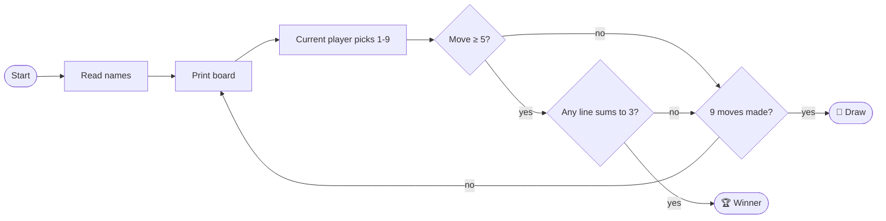

<!-- ═══════════════════════════ HEADER ═══════════════════════════ -->
<p align="center">
  
</p>

<p align="center">
  
</p>

<p align="center">
  
  
  
</p>

<p align="center">
  
  
</p>

---

## 🎮 Play

```text
$ python tictacktoe.py
Enter player 1's name: Alice
Enter player 2's name: Bob
Alice, your character is X
Bob, your character is O
-------------
| X | 2 | O |
|---|---|---|
| 4 | X | 6 |
|---|---|---|
| O | 8 | X |
-------------
Alice has won the game!!!!
```

Pick a square by typing its number, `1` to `9`:

<table align="center">
  <tr><td align="center" width="60"><b>1</b></td><td align="center" width="60"><b>2</b></td><td align="center" width="60"><b>3</b></td></tr>
  <tr><td align="center"><b>4</b></td><td align="center"><b>5</b></td><td align="center"><b>6</b></td></tr>
  <tr><td align="center"><b>7</b></td><td align="center"><b>8</b></td><td align="center"><b>9</b></td></tr>
</table>

---

## 🧠 How it thinks

The board isn't a grid of characters. It's **two parallel occupancy vectors**, one per player:

```python
xState = [0, 0, 0, 0, 0, 0, 0, 0, 0]   # 1 where X has played
zState = [0, 0, 0, 0, 0, 0, 0, 0, 0]   # 1 where O has played
```

A player wins when any of the **8 winning lines** sums to `3` in their vector:

```python
wins = [[0,1,2],[3,4,5],[6,7,8],   # rows
        [0,3,6],[1,4,7],[2,5,8],   # columns
        [0,4,8],[2,4,6]]           # diagonals
```



> ⚡ **Early-exit check.** Nobody can win before the 5th move, so the game skips the win check until then.

---

## 🚀 Run it

```bash
git clone https://github.com/anthonio-alex-dcosta/Tic-Tac-Toe.git
cd Tic-Tac-Toe
python3 tictacktoe.py
```

No installs and no packages. Python 3 is all you need.

---

<p align="center">
  <a href="https://github.com/anthonio-alex-dcosta"></a>
  <a href="https://anthonio-alex-dcosta.github.io/portfolio/"></a>
</p>

<p align="center">
  
</p>
